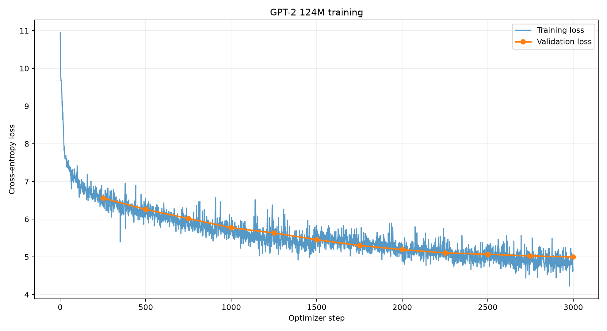
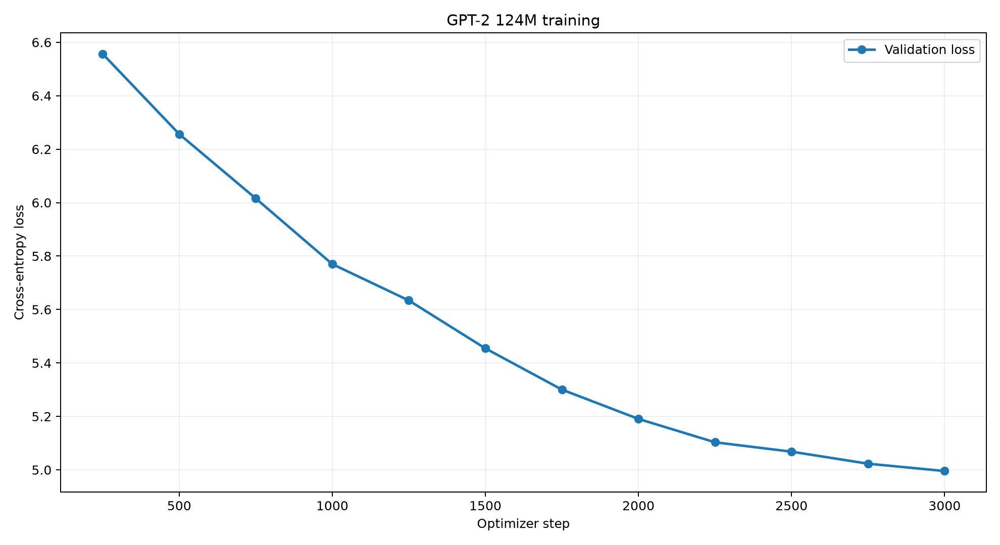

# GPT-2 (124M) Pretraining from Scratch

A PyTorch implementation of a **124M-parameter GPT-2-style decoder-only Transformer**, covering model architecture, distributed training, FineWeb-Edu data preprocessing, mixed-precision optimization, checkpointing, text generation, and language-model evaluation.

The project explores the implementation and training of GPT-style language models, from transformer components to practical pretraining under limited GPU resources.

Alongside a general training implementation with PyTorch DistributedDataParallel (DDP) support, this repository includes a fully documented **49.15-million-token training experiment on an NVIDIA RTX 4050 Laptop GPU with 6GB VRAM**.

## Highlights

- Implemented a GPT-2-style decoder-only Transformer with causal multi-head self-attention, learned positional embeddings, GELU MLPs, residual connections, layer normalization, and tied embeddings.
- Built a pretraining pipeline using AdamW, learning-rate warmup, cosine decay, gradient accumulation, gradient clipping, and BF16 mixed precision.
- Implemented distributed training support using PyTorch DistributedDataParallel (DDP).
- Built tokenized FineWeb-Edu data pipelines with sharded storage and streaming dataset preparation.
- Implemented resumable checkpoints containing model weights, optimizer state, training progress, and data-loader position.
- Integrated validation-loss tracking, HellaSwag evaluation, text generation, and experiment visualization.
- Trained the 124M-parameter model on **49.15M tokens using a single 6GB consumer GPU**.

---

## Experimental Results

### GPT-2 124M — FineWeb-Edu Pretraining

The model was trained from random initialization on a bounded FineWeb-Edu subset.

The experiment focused on demonstrating a functioning GPT-style pretraining pipeline under constrained hardware resources, rather than reproducing the performance of a fully pretrained GPT-2 model.

### Training Configuration

| Parameter | Configuration |
|---|---|
| Model | GPT-2-style Transformer (~124M parameters) |
| GPU | NVIDIA GeForce RTX 4050 Laptop GPU |
| GPU Memory | 6GB |
| Framework | PyTorch + CUDA |
| Precision | BF16 mixed precision |
| Dataset | FineWeb-Edu (`sample-10BT` subset) |
| Unique Training Tokens Prepared | 50,000,000 |
| Validation Tokens Prepared | 1,000,000 |
| Tokens Processed | 49,152,000 |
| Optimizer Steps | 3,000 |
| Micro-batch Size | 1 |
| Sequence Length | 512 |
| Gradient Accumulation Steps | 32 |
| Effective Batch Size | 16,384 tokens |
| Optimizer | AdamW |
| Peak Learning Rate | 6e-4 |
| Learning-Rate Schedule | Linear warmup + cosine decay |
| Validation Interval | 250 steps |
| Checkpoint Interval | 250 steps |

### Measured Performance

| Metric | Result |
|---|---|
| Initial Training Loss | 10.9461 |
| Final Training Loss | **4.6301** |
| First Recorded Validation Loss | 6.5567 |
| Final Recorded Validation Loss | **4.9956** |
| HellaSwag Subset Accuracy | **28.91% (37/128)** |

Training loss declined substantially throughout the experiment, while validation loss decreased at every recorded evaluation point.

The final validation measurement was taken immediately before the last optimizer update. The saved checkpoint contains the completed 3,000 optimizer updates.

### Training and Validation Loss



### Validation Loss Progression



The validation-loss trajectory shows continued improvement throughout training, with smaller reductions toward the end of the learning-rate schedule.

The experiment demonstrates that the model learned meaningful next-token prediction patterns despite limited training compute.

### HellaSwag Evaluation

The final checkpoint was evaluated independently on **128 examples from the HellaSwag validation split**.

| Evaluation | Accuracy |
|---|---|
| Four-choice random baseline | 25.00% |
| Trained model | 28.91% |
| Correct predictions | 37 / 128 |

The result is close to the random-choice baseline and should not be interpreted as evidence of strong commonsense reasoning.

This is a **subset evaluation**, not a result on the complete HellaSwag benchmark.

The standalone evaluator uses integer-normalized labels. An invalid zero-valued HellaSwag entry in the archived training metrics was caused by a label-type mismatch and is superseded by the independent checkpoint evaluation.

### Experiment Artifacts

- [Training Metrics (CSV)](results/rtx4050_50m/metrics.csv)
- [HellaSwag Evaluation Results (JSON)](results/rtx4050_50m/hellaswag_eval_128.json)
- [Training Loss Curves](results/rtx4050_50m/loss_curve.png)
- [Validation Loss Curve](results/rtx4050_50m/validation_curve.png)

---

## Model Architecture

The implementation follows the GPT-2 small architecture, using a stack of causal decoder-only transformer blocks.

| Component | Configuration |
|---|---|
| Architecture | Decoder-only Transformer |
| Parameters | Approximately 124M |
| Transformer Layers | 12 |
| Attention Heads | 12 |
| Embedding Dimension | 768 |
| Maximum Context Length | 1,024 tokens |
| Tokenizer | GPT-2 BPE |
| Vocabulary | 50,304 (padded) |
| Attention | Scaled Dot-Product Causal Attention |
| Activation | GELU |
| Normalization | LayerNorm |
| Positional Encoding | Learned positional embeddings |
| Output Head | Weight-tied language-model head |
| Objective | Autoregressive next-token prediction |

### Transformer Block

Each transformer block contains:

1. Layer normalization
2. Causal multi-head self-attention
3. Residual connection
4. Layer normalization
5. Feed-forward MLP with GELU activation
6. Residual connection

The implementation uses PyTorch's `scaled_dot_product_attention` with causal masking, allowing optimized attention kernels when supported by the hardware and execution configuration.

### Weight Initialization

Linear layers use normal initialization, with residual projection weights scaled according to transformer depth.

Input token embeddings and the language-model output head share parameters through weight tying.

---

## Pretraining Pipeline

### 1. Dataset Preparation

The training data is drawn from Hugging Face's FineWeb-Edu dataset.

The preprocessing pipeline:

- Streams or loads dataset documents.
- Tokenizes text using the GPT-2 BPE tokenizer through `tiktoken`.
- Inserts end-of-text tokens between documents.
- Stores token IDs as NumPy arrays.
- Separates training and validation data.
- Produces token shards for efficient loading.

The bounded experiment uses `fineweb_50m.py` to prepare approximately 50M training tokens and 1M validation tokens.

The larger preprocessing implementation is available in `fineweb.py`.

### 2. Training and Optimization

The training implementation uses:

- AdamW optimization with weight decay
- Linear learning-rate warmup
- Cosine learning-rate decay
- Gradient clipping
- Gradient accumulation
- BF16 mixed-precision computation
- Periodic validation
- Checkpoint saving and restoration

Gradient accumulation enables a larger effective token batch without requiring the entire batch to fit into GPU memory.

For the RTX 4050 experiment:

```text
Micro-batch size      = 1
Sequence length       = 512
Gradient accumulation = 32

Effective batch = 1 × 512 × 32
                = 16,384 tokens
```

### 3. Distributed Training Support

The general training implementation includes PyTorch DistributedDataParallel (DDP) support.

Under DDP, each worker maintains a model replica, processes a separate portion of the training batch, and participates in gradient synchronization.

The documented 50M-token experiment was conducted on **one RTX 4050 GPU**, without DDP.

### 4. Checkpointing and Resumption

The resource-constrained training implementation supports periodic checkpointing.

Checkpoints include:

- Model parameters
- Optimizer state
- Model configuration
- Next optimizer step
- Training data-loader position
- Random-number-generator state
- Training configuration metadata

Checkpoints are written through a temporary file followed by an atomic replacement operation to reduce the risk of incomplete final checkpoint files.

This enables interrupted runs to resume without restarting training from random initialization, subject to the supported configuration and dataset consistency requirements.

---

## Evaluation

### Validation Loss

Validation loss is computed using held-out tokenized FineWeb-Edu data.

Measurements are recorded throughout training and used to monitor convergence.

### HellaSwag

HellaSwag evaluates a language model's ability to select the most plausible continuation from four candidate endings.

For each example:

1. Tokenize the context and candidate endings.
2. Run the model on each candidate sequence.
3. Compute token-level cross-entropy losses.
4. Restrict scoring to the candidate-completion tokens.
5. Select the candidate with the lowest average completion loss.
6. Compare the prediction against the ground-truth label.

The implementation evaluates candidate sequences individually to reduce peak GPU memory usage.

A standalone checkpoint evaluator is included in `eval_hellaswag.py`.

### Text Generation

Text generation uses autoregressive sampling.

Given a prompt, the model repeatedly predicts the next-token distribution and samples a continuation using top-k sampling.

Generated text provides a qualitative demonstration of the model's learned language patterns, but is not used as a substitute for quantitative evaluation.

---

## Repository Structure

```text
nanogpt/
├── README.md
├── requirements.txt
├── .gitignore
│
├── train_gpt2.py
├── train_gpt2_overnight.py
│
├── fineweb.py
├── fineweb_50m.py
├── fineweb_small.py
│
├── hellaswag.py
├── eval_hellaswag.py
├── plot_training.py
│
└── results/
    └── rtx4050_50m/
        ├── metrics.csv
        ├── hellaswag_eval_128.json
        ├── loss_curve.png
        └── validation_curve.png
```

Tokenized datasets, model checkpoints, local environments, and raw training logs are excluded from ordinary Git history.

---

## Getting Started

### Requirements

- Python with compatible project dependencies
- PyTorch with CUDA support for NVIDIA GPU training
- NumPy
- tiktoken
- Hugging Face Datasets
- tqdm
- Matplotlib for generating plots

An NVIDIA GPU is recommended for training the 124M-parameter model.

### Installation

Clone the repository:

```bash
git clone https://github.com/sanchit-pareek/nanogpt.git
cd nanogpt
```

Create and activate a virtual environment.

On Windows PowerShell:

```powershell
python -m venv .venv
.\.venv\Scripts\Activate.ps1
```

Install project dependencies:

```powershell
python -m pip install -r requirements.txt
```

Ensure your installed PyTorch build supports CUDA. If necessary, use the official [PyTorch installation selector](https://pytorch.org/get-started/locally/) to install a compatible GPU-enabled build.

Verify CUDA availability:

```powershell
python -c "import torch; print(torch.cuda.is_available())"
```

Expected output on a correctly configured CUDA system:

```text
True
```

### Prepare the Dataset

Generate the bounded FineWeb-Edu dataset:

```powershell
python -u .\fineweb_50m.py
```

The script prepares tokenized training and validation shards under:

```text
edu_fineweb_50M/
```

Dataset preparation requires internet access and sufficient local disk space.

### Run the RTX 4050 Experiment

The following PowerShell configuration matches the documented local experiment:

```powershell
Remove-Item Env:NANOGPT_RESUME -ErrorAction SilentlyContinue
Remove-Item Env:NANOGPT_RUN_ID -ErrorAction SilentlyContinue

$env:PYTHONIOENCODING = "utf-8"
$env:NANOGPT_DATA_DIR = "edu_fineweb_50M"

$env:NANOGPT_BATCH = "1"
$env:NANOGPT_SEQ_LEN = "512"
$env:NANOGPT_TOKENS_PER_STEP = "16384"

$env:NANOGPT_MAX_STEPS = "3000"
$env:NANOGPT_VAL_INTERVAL = "250"
$env:NANOGPT_CKPT_INTERVAL = "250"

$env:NANOGPT_HELLA_INTERVAL = "3000"
$env:NANOGPT_HELLA_EXAMPLES = "128"

python -u .\train_gpt2_overnight.py
```

The script saves results in a timestamped directory under `log/`.

Example:

```text
log/
└── <run_id>/
    ├── log.txt
    ├── metrics.csv
    └── latest.pt
```

The experiment's reported metrics come from the original completed run. Repeating it on another system does not guarantee identical results.

### Resume Training

To resume an interrupted run, preserve the original training configuration and dataset.

Set the checkpoint path:

```powershell
$env:NANOGPT_RESUME = "log\<run_id>\latest.pt"
```

Then execute:

```powershell
python -u .\train_gpt2_overnight.py
```

The script restores the saved state and continues from the recorded optimizer step.

The checkpoint loading mechanism should only be used with trusted local checkpoints.

### Evaluate a Checkpoint

Run the standalone HellaSwag evaluator:

```powershell
python -u .\eval_hellaswag.py `
  --checkpoint "log\<run_id>\latest.pt" `
  --examples 128
```

The evaluator prints the measured accuracy and saves the results alongside the checkpoint.

To evaluate more examples, change the `--examples` argument.

Always report the number of evaluated examples when presenting subset accuracy.

### Plot Training Metrics

Install Matplotlib if needed:

```powershell
python -m pip install matplotlib
```

Generate training curves:

```powershell
python .\plot_training.py `
  --metrics "log\<run_id>\metrics.csv"
```

This produces training and validation-loss visualizations from the recorded experiment metrics.

---

## Limitations and Future Work

The experiment successfully demonstrates GPT-style model implementation, pretraining, checkpointing, and evaluation on resource-constrained hardware.

However, several limitations remain:

- **Training compute:** The experiment processed approximately 49.15M tokens, substantially fewer than full-scale GPT-2 pretraining.
- **Model quality:** The model remains far below the capabilities of a fully pretrained GPT-2 language model.
- **Benchmark scope:** HellaSwag accuracy was measured on 128 examples, not the complete validation set.
- **Hardware:** Training was conducted on a single consumer GPU, limiting practical training scale.
- **Context length:** The local experiment used 512-token sequences despite supporting a maximum context length of 1,024 tokens.

Potential future work includes larger-scale pretraining, expanded evaluation, throughput optimization, and systematic comparisons across training configurations.

---

## Acknowledgments and References

This project was developed as a hands-on exploration of GPT-style language-model training, building on established research and educational implementations.

- [Andrej Karpathy — Let's reproduce GPT-2 (124M)](https://github.com/karpathy/build-nanogpt)
- [OpenAI — Language Models are Unsupervised Multitask Learners](https://cdn.openai.com/better-language-models/language_models_are_unsupervised_multitask_learners.pdf)
- [PyTorch Documentation](https://pytorch.org/docs/stable/index.html)
- [Hugging Face — FineWeb-Edu](https://huggingface.co/datasets/HuggingFaceFW/fineweb-edu)
- [HellaSwag — Can a Machine Really Finish Your Sentence?](https://arxiv.org/abs/1905.07830)

---

## Author

**Sanchit Pareek**

B.Tech — Mathematics and Scientific Computing  
National Institute of Technology Hamirpur

[GitHub](https://github.com/sanchit-pareek) | [LinkedIn](https://www.linkedin.com/in/sanchit-pareek/)
